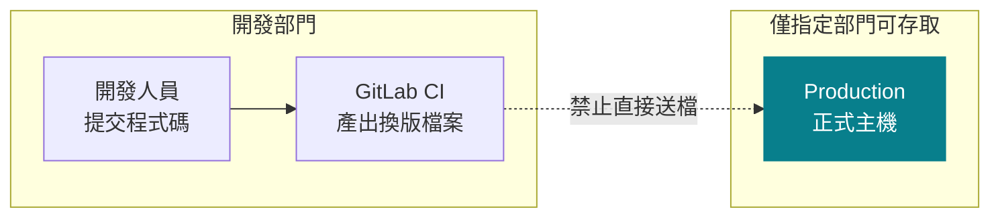
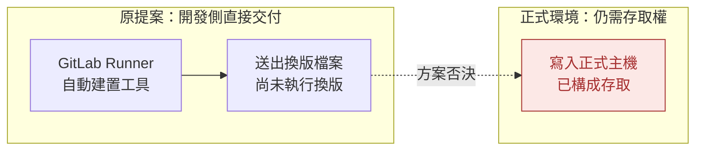
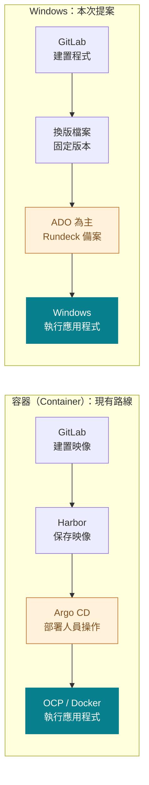
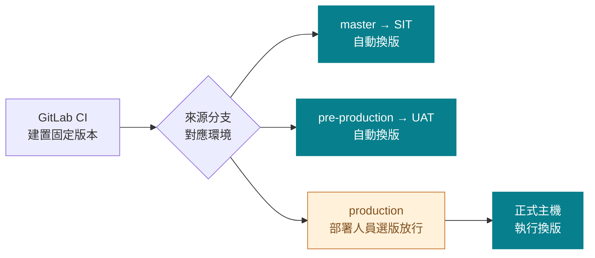
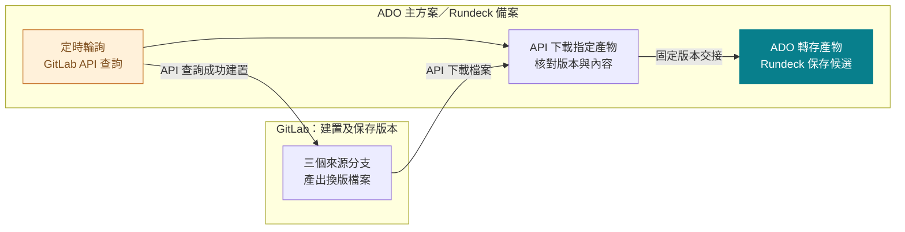
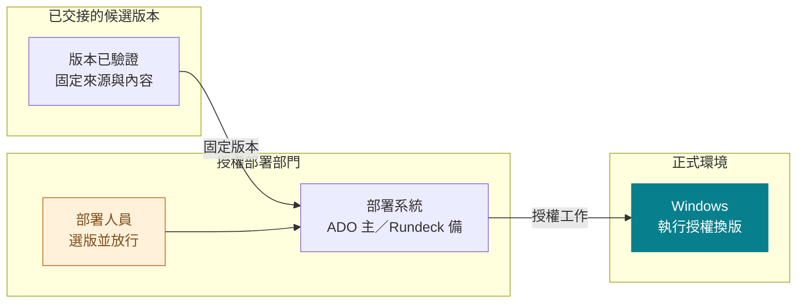
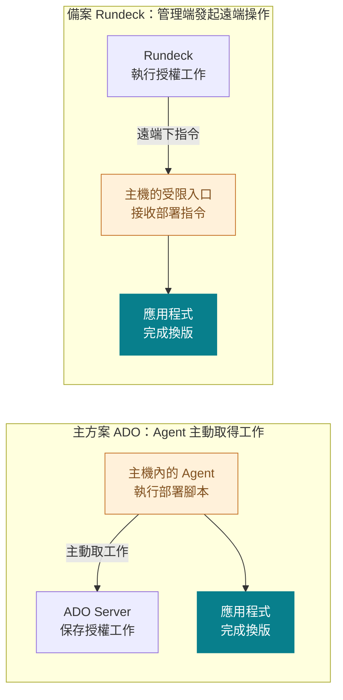
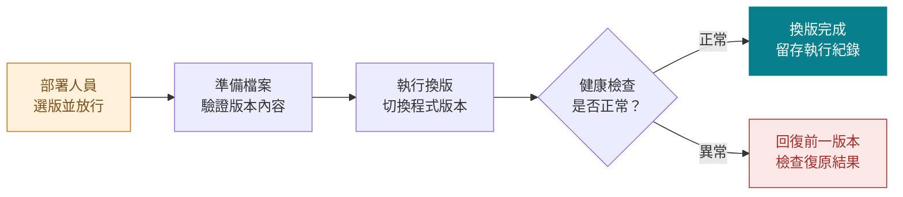

# Windows 正式部署治理計劃
> 讓開發自動化，讓正式換版有授權、有紀錄、可復原

## 跨部門可行性與合規討論
- 初步提案｜正式上線仍需依組織程序批准
- Azure DevOps Server（ADO）為主方案；Rundeck 為備案

<!-- notes
本簡報以跨部門溝通為目的，聚焦背景、責任邊界、兩種部署機制與實際換版流程。共 10 頁，無附錄，聚焦本案背景與目標設計，避免測試環境細節。ADO 為主要規劃方向，Rundeck 為備案；這不等於正式上線已獲批准。簡報設計依據另見 docs/research/presentation-design-guidance.md。
-->

---

# 我們要解決的，是正式主機的存取邊界
> 能建置程式，不代表有權把檔案送進正式環境

## 本案必要原則
- 就算只是複製檔案，也屬正式主機存取；不能視為例外。

<!-- notes
Production 僅限特定部門存取，是已確認的組織限制。現行 GitLab CE 是 Git Server；開發人員可執行建置，但正式部署需要另設授權邊界。不是宣稱 GitLab CE 完全沒有權限控制。圖中虛線是禁止的路徑。換版檔案即 Artifact；CI 是自動建置與測試。具體存取政策依組織正式規範。
-->

---

# 先前「只送檔案、不換版」的方案已被否決
> 原因不是技術做不到，而是違反部門存取限制

## 因此改變方向
- 建置端不碰正式主機，正式交付與換版改由授權部門管理。

<!-- notes
此為方案演進背景，不是仍在評估的候選。Runner 是執行 GitLab 建置工作的服務。即使只 Deliver，正式檔案寫入仍需存取權；不得以共用帳號、掛載目錄或中繼腳本繞過部門邊界。換成部署平台不自動合規，帳號、網路與管理權仍須由授權部門掌握。
-->

---

# 容器已有部署路線，Windows 要補上同樣的分工
> 沿用「建置與正式換版分離」的原則，不強迫使用相同工具

## 類比重點
- 兩條路線都需要「誰可以換版」；不是只有「怎麼把檔案送過去」。

<!-- notes
Container 是現有 GitLab CE、Harbor、Argo CD、OCP／Docker VM 流程，部署人員在 Argo CD 進行換版操作。此為責任分工類比，不宣稱 Windows 等同 GitOps，也不宣稱原生工具自動滿足所有審批要求。Windows Artifact 可從 GitLab 或受控中繼儲存取得；儲存及保留設計另行確認。ADO 與 Rundeck 是替代路線，不要求兩套串接或同時操作正式主機。
-->

---

# 三個分支對應三個環境，正式部署多一道人工放行
> master＝SIT；pre-production＝UAT；production＝正式環境

## 正式部署的必要條件
- 三個分支各自建置；正式版本先放行，才執行後續換版。

<!-- notes
分支維持 master＝SIT、pre-production＝UAT、production＝Production；各分支各自建置，不主張 UAT 與 Production 使用同一份內容。同一 Artifact 跨環境晉升可後續評估。GitLab 通知、CD 輪詢或人工選取都可，通知本身不是正式放行。放行綁定應用程式、版本內容與目標，變更須重新放行。單一授權部署人員可放行並執行，暫不強制雙人審批。
-->

---

# 建置產物交接：輪詢發現版本，API 下載檔案
> 採部署側輪詢＋GitLab API；Webhook 可作通知，但不搬運檔案

## 串接方式
- 輪詢發現版本、API 下載檔案；需部署側串接程式，非原生直連。

<!-- notes
本頁以官方文件查證功能可行性，不宣稱完成現場整合測試。Polling 是定時發現新版本的方法，GitLab REST API 才是查詢與下載介面；Webhook 只通知建置事件，不搬運 ZIP，也不代表正式放行。圖中 B→A 表示部署側發起查詢；A→C 表示經 API 取回檔案，下載仍由部署側主動發起。
在 ADO 管理端排程受保護的 Collector Build（它本身不作 Release 產物來源），定時查詢 GitLab，只有發現新候選才排入對應 Import Build（透過 Server Build Queue REST API）；Import Build 在管理端 Agent 重新核對 GitLab metadata、下載檔案並用 PublishBuildArtifacts@1 轉存 Server Build Artifacts。避免每次無更新的輪詢都建立可觸發 Release 的成功空 Build。Collector 與 Importer 是需自行實作的串接程式；不是 ADO Server 原生的 GitLab Artifact source。兩者不在 Production 執行、不持有 Production 部署／核准權；GitLab 唯讀 Token 只放管理端。排入 Build 的 API 權限僅限固定 Import definitions，不能執行 Production Release。
建立三組受保護的 Import Build＋Classic Release：master／SIT、pre-production／UAT、production／Production。各 Importer 固定查對應的 GitLab ref，Release 綁定該 Import Build 的確切版本。ADO 自己存放串接程式的 repository branch（例如 main）不是 GitLab 來源分支，不能拿 Build.SourceBranch 直接當原 GitLab 環境分流。SIT／UAT 啟用 importer Artifact 的 CD trigger 與 After release 自動 stage；Production 關閉 Artifact 自動 release trigger，指定 Deployer 選 Import Build 建立 release，stage 設 Manual only、指定 pre-deployment approvers，限制定義／觸發／核准者與 Agent 資源的修改。放行前不先將正式檔案送入 Production。
Rundeck 備案：由受控排程 Collector 使用相同 GitLab API 與驗證規則保存候選，固定 master／pre-production 對應 SIT／UAT Jobs 自動執行，Production Job 不排程，僅 Deployer 能選定候選並 RUN。OSS 不被描述為自動具備 ADO 等同的審批產品能力。
GitLab API（省略 host，前綴 /api/v4）：GET /projects/P/pipelines?ref=master&source=push&status=success&order_by=id&sort=desc；GET /projects/P/pipelines/L；GET /projects/P/pipelines/L/jobs?scope[]=success&include_retried=false；GET /projects/P/jobs/J；GET /projects/P/jobs/J/artifacts。重驗固定專案、確切來源 ref、pipeline success、source=push、job.tag=false、commit SHA、允許的產物 Job 名稱與 job/pipeline 關聯。不信任 webhook、使用者輸入或 ZIP manifest 自行宣稱的 branch／environment。排除 MR、tag、child 等未允許來源。以 project/pipeline/job ID 鎖定內容，不使用正式部署時會變動的 latest 下載。
需設計去重、順序、鎖、失敗重試與保留：保存 job→candidate/import build 的對應，不因重複輪詢重複部署；較舊 pipeline 晚完成不覆蓋較新版本；GitLab 產物到期前先轉存，保留來源、hash 與回滾所需內容。Job ID 固定不等於檔案永不刪除。處理外層 Artifact ZIP 與內層應用程式 ZIP，驗證路徑／大小／內容，不能直接執行開發者提供的特權部署腳本。
Webhook 可改為 GitLab → 受控接收端 → 驗證 secret 與事件 → API 重查及下載，仍需自製接收程式與重放／去重防護。初步採輪詢以減少新進站服務與 GitLab 持有 CD 執行權限的需求；不推薦把可部署 Production 的 ADO／Rundeck Token 放在開發者可控的 CI Job。
完整查證及版本邊界見 docs/research/gitlab-cd-artifact-handoff.md。參考 API 版本以 ADO Server 2022／REST 7.0 為基準；實際版本、任務、排程及有效 ACL 仍需現場測試。
官方來源：
https://docs.gitlab.com/api/pipelines/
https://docs.gitlab.com/api/jobs/
https://docs.gitlab.com/api/job_artifacts/
https://docs.gitlab.com/user/project/integrations/webhooks/
https://learn.microsoft.com/en-us/rest/api/azure/devops/build/builds/queue?view=azure-devops-rest-7.0
https://learn.microsoft.com/en-us/azure/devops/pipelines/tasks/reference/publish-build-artifacts-v1?view=azure-pipelines-server
https://learn.microsoft.com/en-us/azure/devops/pipelines/release/artifacts?view=azure-devops-server
https://learn.microsoft.com/en-us/azure/devops/pipelines/release/triggers?view=azure-devops-server
https://learn.microsoft.com/en-us/azure/devops/pipelines/release/approvals/approvals?view=azure-devops-server
https://docs.rundeck.com/docs/manual/document-format-reference/job-yaml-v12.html
https://docs.rundeck.com/docs/api/#running-a-job
-->

---

# 正式環境共通流程：授權選版放行，再執行換版
> ADO 為主方案（已有內部運行先例），Rundeck 為備案

## 共通原則
- 放行綁定確切版本與目標；兩套方案擇一，執行方式見下一頁。

<!-- notes
合併原第 7／8 頁，只說明正式部署的共通操作與責任，不重複描述兩套執行機制。第 6 頁先交接並保存已驗證候選；本頁由授權部署人員選定版本、目標並放行，部署系統再安排 Windows 換版。SIT／UAT 自動流程仍依第 5 頁環境政策；本頁人工放行圖專指 Production。ADO 是主方案，有其他部門已在運行的先例；Rundeck 是替代備案，不要求兩套串接或同時操作同一正式主機。先例不等於本專案正式上線驗收。
圖中箭頭是版本／工作交接方向，不是完整網路拓撲。實際差別統一放在第 8 頁：ADO 的專用 Agent 主動連 Server 取工作，在本機執行；Rundeck 管理端透過 HTTPS WinRM／PSRP 呼叫 JEA 受限入口，Windows 執行允許的部署功能。此為本案路線，不宣稱 Rundeck 只能遠端操作。
帳號、工作定義、Agent／遠端入口、憑證及必要特權均由授權部門控管；不開放一般管理 shell，不把 Target 放一般 CI pool，也不因方便授予 Administrator／SYSTEM。Agent 不是安全沙箱，JEA 亦不取代完整 OS 權限與部署定義保護。GitLab 唯讀 Token 留管理端，不放正式目標。
官方架構：https://learn.microsoft.com/en-us/azure/devops/pipelines/agents/agents?view=azure-devops-server
Deployment Group：https://learn.microsoft.com/en-us/azure/devops/pipelines/release/deployment-groups/?view=azure-devops-server
-->

---

# 核心差異：主機主動取工作，或管理端遠端下指令
> 兩者最後都在 Windows 執行；差別是工作如何交付與受控

## 操作與維運差異
- ADO 要管理 Agent；Rundeck 要管理遠端入口、連線與憑證。

<!-- notes
本圖上半部 B→A 表示 Agent 主動連線取得授權工作，並不表示把部署任務送回 Server；取回工作後 B→C 在同一正式主機本機執行。下半部 D→E 表示 Rundeck 發起遠端部署請求，E→F 仍在正式主機本機執行。兩條路線都是由授權部門管理，不允許開發側直接存取 Production。ADO 不因使用 Agent 就自動更安全；Rundeck 也不因遠端操作就等於提供一般管理權。前者需維護 Agent 安裝更新、服務身份與專用部署資源；後者需維護遠端端點、憑證、限定命令及連線可用性。結果、日誌及部署責任皆需回報控制面。多台 Target 的 ADO Agent 各自執行；Rundeck 依 Target 逐台遠端執行，兩者均可採逐台健康驗證與失敗停止策略。
-->

---

# 工作到達主機後，換版步驟其實相同
> 準備指定版本、執行切換、檢查結果；失敗時回復

## 不同的是執行入口
- ADO 由 Agent 本機執行；Rundeck 遠端呼叫受限功能；皆需設計復原。

<!-- notes
此為目標換版流程，不代表兩產品原生自動具備完整回滾或原子交易。放行後，準備指定版本、核對來源／hash，保存目前版本與復原所需資料，依應用程式需求停止或切換服務、套用版本與環境設定、重新啟動並健康驗證。成功記錄版本、人員、目標與結果。若換版或驗證失敗，依既定程序回復可用版本；若復原仍失敗，停止並通知負責人，不顯示成功。停止／啟動服務只是可能方式，不承諾零停機；不同 IIS／Windows Service 應用須各自設計。Agent 執行能力與遠端命令執行能力都不自動提供回滾，需事先設計並驗證腳本及保留資料。
-->

---

# 不論主方案或備案，正式換版都要安全且可復原
> ADO 為主要路線，Rundeck 備用；不能省略同一套部署要求

## 權限要擋得住
- 未授權人員不能送檔或觸發正式換版。
- 開發者可控內容不能替換特權部署指令。
- 能辨識真正的放行人員。

## 版本要對得上
- 放行後出現新版本，仍部署原先選定的版本。
- 檔案遭替換或內容不符時，拒絕部署。
- 同一主機不會同時進行衝突換版。

## 失敗要救得回
- 換版後確認應用程式正常。
- 多台逐台執行；失敗停止後續換版。
- 能回滾或受控復原，不把未知狀態當成功。

<!-- notes
本頁作為簡報收束，保留共同治理要求，不另設合規角色矩陣、階段選型路線或會議決議頁。正式服務帳號、網路、稽核保留與職責分離依組織政策；本簡報不宣稱已合規。開發者修改 repo／Artifact 的腳本不能變成未受審查的特權部署命令。版本名稱固定不等於內容固定，執行前須核對被放行內容。多主機失敗時先恢復失敗目標，再由部署人員決定是否回滾已成功目標，不承諾跨主機原子交易或全群自動回滾。
ADO Classic Release 自動部署不檢查 release creator 的 Manage deployments 權限；正式流程不能只禁止手動 Deploy，要保護自動觸發、工作定義、批准者及 Agent 資源權限。此為治理實作注意事項，不是 Express 版本限制。不得直接套用 Azure DevOps Services 的 YAML Approvals and Checks 作為 Server 的能力承諾。
官方來源：https://learn.microsoft.com/en-us/azure/devops/organizations/security/permissions?view=azure-devops-server
https://learn.microsoft.com/en-us/azure/devops/pipelines/policies/permissions?view=azure-devops-server
https://learn.microsoft.com/en-us/azure/devops/pipelines/release/approvals/approvals?view=azure-devops-server
https://learn.microsoft.com/en-us/azure/devops/pipelines/process/approvals?view=azure-devops-server
-->
