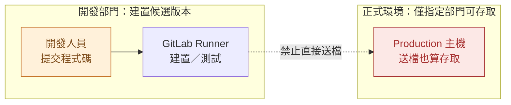
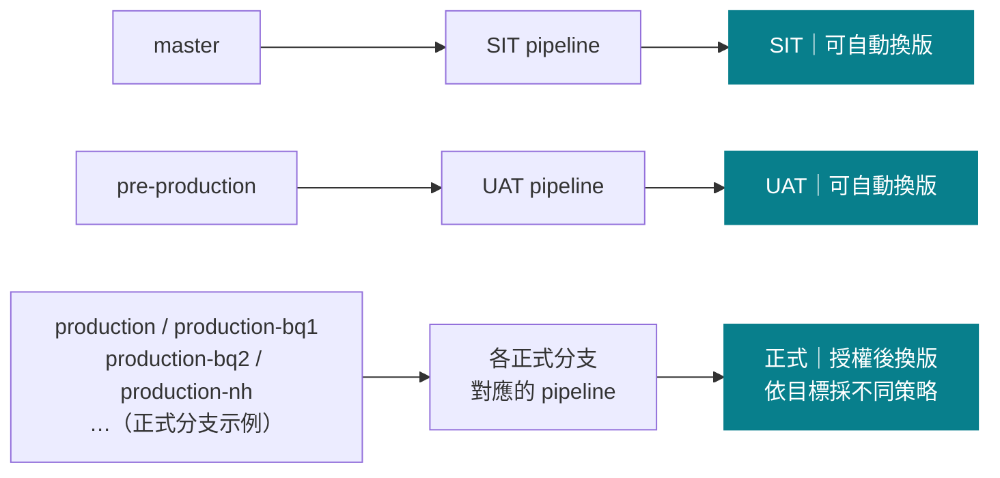
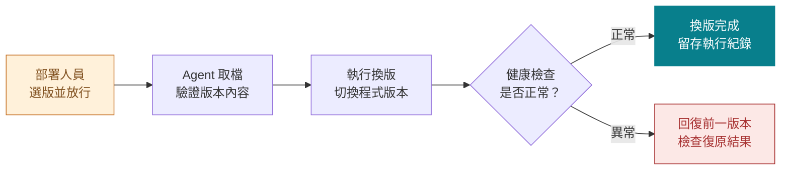
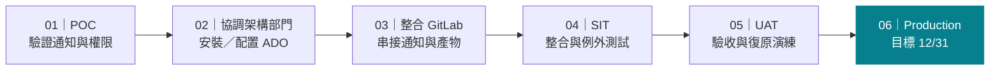

# Windows 正式部署治理計劃
> 保留 GitLab 建置，讓正式換版由授權部門掌握

## Azure DevOps Server 導入提案
- 本次為需求與技術方向提案｜尚未完成實作或 POC 驗證
- Express 作為 POC 起點｜正式版本另行確認
- 跨部門討論稿｜目標 12/31，時程待共同確認

<!-- notes
共 9 頁：封面、議程、7 頁內容（含預期效益、需求與驗證狀態、最後的建議時程），無附錄。僅討論 Azure DevOps Server；Express 是 POC 起點，不代表最終採購決策。保留 GitLab CE 作版本控制與 CI。其他部門已有 ADO 運行先例，是使用者提供的背景，不是本案整合或合規已通過的證據。12/31 年份未指定，不自行補年份。產品能力依官方文件查證，尚未完成本架構的實機驗證。
-->

---

# 今天看六件事：效益、邊界、架構、環境、換版與時程
> 先說明預期價值，再區分需求、規劃與待驗證項目

## 為什麼做
- 01｜預期效益
- 02｜正式主機存取邊界

## 規劃怎麼做
- 03｜需求狀態與目標架構
- 04｜分支與部署策略

## 如何落地
- 05｜授權換版與復原設計
- 06｜POC 到正式上線

<!-- notes
先說明對維運、風險及跨專案複用的預期價值，再交代正式主機存取限制。以獨立狀態頁區分已確認需求、規劃做法及 POC 待驗證項目；技術架構與流程均非已完成成果。第 6 頁上半部以 ①～⑧ 說明交付架構，下半部展開單台換版與復原。詳細閱讀可放大獨立 PDF／draw.io。
-->

---

# 預期效益：維運更一致、風險可控、經驗可複用
> 完成導入並通過驗收後，預期帶來三項改善

## 維運更一致
- 選版、換版與留存紀錄採一致流程，減少人工搬檔與漏步。
- 可查誰在何時、對哪台主機部署哪個版本，縮短問題追查。

## 降低操作風險
- 版本與目標綁定放行，降低未授權存取與送錯版本風險。
- 備份與復原演練，降低換版失敗的影響。

## 複用到其他專案
- 沉澱權限、交付、放行與紀錄範本，減少重複設計。
- 其他 Windows 專案可沿用框架；服務與復原方式仍須個別驗證。

<!-- notes
本頁為預期效益，不是已達成的成果；目前沒有導入前後量測數據，不承諾節省比例、復原時間或零停機。POC／試辦時記錄人工步驟、換版耗時、版本追查所需時間與復原演練結果，再與既有流程比較。備份與復原需實作及演練，不能因採用 ADO／Agent 就視為風險已消除。可複用的是治理與操作框架，不是將同一套腳本直接套用所有 Windows 專案；IIS／Windows Service、設定、資料相容及 F5 範圍須各別確認。
-->

---

# 只送檔、不換版，仍然越過正式主機存取邊界
> 原方案已否決：建置端不能直接碰正式主機

## 改變方向
- 保留建置自動化；檔案送入正式主機與換版，都改由授權流程執行。

<!-- notes
本頁合併舊版第 2、3 頁。只送檔、不執行換版的提案已被否決，原因是正式主機僅允許指定部門存取，複製檔案也屬存取；不是技術做不到，也不是宣稱 GitLab CE 沒有權限控制。虛線代表禁止路徑。現有 Container 鏈 GitLab → Harbor → Argo CD → OCP／Docker 可作責任分工類比，本案補上 Windows 的受控部署流程，不要求使用相同工具。建置端不能透過共用目錄、帳號或中繼腳本繞過 Production 邊界。
-->

---

# 本次提案狀態：需求已確認，做法仍待驗證
> 官方文件支持工具能力，不代表本案已完成整合或驗收

## 已確認的需求
- 保留 GitLab 建置；正式主機僅限指定部門存取。
- 正式部署須先選定版本與目標、授權放行；送檔也算存取。

## 規劃中的做法
- 以 Azure DevOps Server 管理放行，由目標 Agent 執行受控腳本。
- 納入備份、健康檢查與復原；需另行實作，並非工具自帶完整機制。

## POC 待驗證
- GitLab 串接、Agent 權限與放行前禁止送檔。
- F5 隔離、人工確認、備份還原及失敗停止；含失聯例外。

<!-- notes
本頁為證據範圍說明，不是進度百分比。已確認需求來自本案討論；工具能力依官方文件查核，包含核准、指定版本產物、Deployment Group 與腳本執行。尚未完成本案 ADO／Agent 安裝整合、備份復原腳本或實機 POC 驗證，不將其他部門的運行先例視為本案成果。Express 僅是 POC 起點，正式版本、責任分工與資源待協調。POC 須驗證正向及負向情境，通過後才能宣稱對應控制已有效；測試證據應記錄環境、版本、案例及結果。
-->

---

# 規劃架構：從提交程式碼到多機換版與復原
> 規劃做法／待 POC：放行才部署，健康且人工確認後才恢復流量

<!-- notes
本頁管理區改以三段關係說明：「成功通知 → 取得並保存版本 → 人員選版／選目標、確認放行」。這是簡化的業務流程視圖，不是取消中間串接元件；ADO 管理側包含受保護接收器及管理 Build Agent，不能將平台標題誤讀成全部由 ADO Server 本機執行或已有原生 GitLab 直連。技術細節保留於以下備註及研究文件，不要求所有聽眾理解 API、Importer 或 hash。
本頁採完整架構圖圖片，PPTX 中是高解析圖片，可編輯節點、容器與連線的原檔為 docs/presentations/diagrams/windows-deployment-map.drawio；獨立 PDF 可放大閱讀。圖內主架構與單台換版流程是兩個明確分隔的視圖，不是假裝一張純網路拓樸。圖面研究見 docs/research/end-to-end-architecture-diagram-design.md。
使用者確認：替換原第 4 頁（現第 6 頁）；「下 F5／上 F5」分別表示將目標服務退出／恢復負載平衡流量。具體 pool/member、Disabled 或 Forced Offline、連線等待／逾時、F5 操作位置與身分仍待網路及主機團隊確認。不能從圖推論每台 Agent 持有 F5 管理權；實作時需接上受保護、可稽核的維護操作。F5 流量線指向應用，不是 Agent；一台主機可能有多個 pool members，須確認完整範圍。
上半部是交付架構：開發人員 push GitLab CE；GitLab 編排 CI，GitLab Runner 建置／測試並上傳 artifact。GitLab pipeline 成功事件通知受保護接收器，接收器驗證、耐久入列、API 複核後，以 Queue Build REST API 排入固定 importer。接收器與驗證／去重邏輯需實作，不是原生 GitLab artifact connector，也不需要新增 GitLab Runner。
ADO 管理區的 self-hosted Build Agent 重驗專案、pipeline、ref、SHA 與必要品質 jobs，按確切 project/pipeline/job ID 下載 GitLab 產物，驗 ZIP／hash 並保存 manifest，以 PublishBuildArtifacts@1 發布 Server Build Artifacts。不能抓 latest 或使用 Services-only Pipeline Artifacts。GitLab 唯讀憑證只留管理區；管理 Agent、接收器和 CI 都無 Production 存取權。
ADO 全名 Azure DevOps Server；Express 為 POC 起點，Server 2022／REST 7.0 作文件基線。ADO 控制面、版本庫、管理 Agent 是邏輯元件，不等於必須各有一台 VM。這是文件支持的目標設計，不是現況或實機測通的證明。
Production 關閉 artifact 自動 release trigger，授權人員選確切 importer build、應用與目標建立 Classic Release，stage 設 Manual only 與具名 pre-deployment approval；允許同一人發起與放行。任何版本／目標變更須重新放行。分支與部署策略留下一頁說明。
放行後，各 Windows Target 上的專用 Deployment Group Agent 才取指定工作與產物，在本機執行受保護的部署腳本。Agent 主動連 ADO 取工作；派工箭頭不代表 Server 主動登入 Windows。放行前不得預拷，包含 Production Agent 工作目錄。管理 Agent 與目標 Agent 必須隔離帳號、pool／Deployment Group、主機與憑證，不能執行開發者提供的特權部署腳本。
Production 圖示 01、02、…、N，可涵蓋數十台主機；不代表所有主機同時換版，也不是 Agent 互相傳檔。暫建議逐台或受控分批，健康後繼續，任一失敗停止後續目標；批次大小、最低容量、先前成功目標是否回復仍待確認。不承諾零停機或跨主機原子交易。
下半部新增強制人工關卡：⑦ 僅檢查服務／排程是否正常啟動；新版與復原舊版兩條路徑，都須由部署人員在隔離狀態驗證功能正常、確認放行後，才能執行⑧ 上 F5。人工節點沿用部署人員橘色，非 Agent 自動判定。新版功能驗證不通過走退版；舊版功能不通過保持隔離並通知。未確認、拒絕或逾時均不得恢復流量；逾時不視為自動同意，也不必然等同功能測試失敗。驗證須透過核准的隔離測試入口／直連方式，不為測試而預先恢復正式流量；實際入口與驗證項目待確認。
實作需把「部署／自動檢查」「人工功能驗證」「恢復流量」分成可強制等待與續行的控制步驟。初始 Release 的部署前核准不能代替此次中途關卡；需設計 Server Classic 支援的人工等待／分階段核准或受控外部編排，驗證成功續行、拒絕、逾時、Agent 失聯與回線對帳。人工決定綁定 release、target、版本及此次檢查結果，等待期間保留隔離與部署鎖；舊版復原也要有獨立確認，不可沿用新版確認。這是新增目標要求，尚未實作或實測。
下半部更新為白話版並統一使用 ①～⑧ 圈號：① 取得已放行版本 → ② 下 F5 → ③ 停止服務 → ④ 備份舊版本 → ⑤ 安裝新版本 → ⑥ 重啟服務 → ⑦ 服務正常？ → ⑧ 上 F5。失敗路徑是還原舊版本、重啟與再檢查；成功恢復後仍記本次換版失敗。原本的鎖、前置閘門、有效備份、流量狀態核對與例外要求仍需實作，僅不放進主流程的長標籤。Agent／主機失聯不是同一個 Agent 能保證自動復原的情況，須另有監控及受控人工／獨立復原手段。
下半部對每個核准目標重複：放行後下載／驗證、部署鎖與前置檢查 → 下 F5 並確認流量隔離條件 → 停止服務 → 備份目前版本 → 執行換版 → 重啟服務 → 檢查狀態。正常且部署人員確認功能正常，才上 F5，確認恢復成功後記錄新版本完成。
換版、啟動或健康檢查失敗時，保持隔離，依受控腳本停止失敗版本、回復有效備份、重啟，再做復原健康檢查；正常且部署人員再次確認舊版功能正常，才上 F5 並記錄「換版失敗、復原成功」，不能記為新版本部署成功。復原不健康或無可用備份時，保持隔離、停止後續換版、告警並交人員處理。
下 F5／隔離確認失敗時不能繼續停止服務；停止或備份失敗時不能覆寫版本，由受控復原／人工程序決定後續。上 F5 操作或確認失敗不能算完成。檔案備份不等於資料庫回復，資料相容與復原另行設計。服務停止／重啟需依 IIS／Windows Service 細化。備份與復原腳本必須演練，ADO／Agent 不自動提供完整應用復原。
安全與可靠性驗收：測試 PAT／definition ACL／群組繼承、queue 參數與來源覆寫、build service／OS 身分、特權腳本保護；測試事件偽造、重送、晚到舊版本、Queue 回應遺失、產物到期、零預拷、拒絕或復原失敗時不恢復流量。版本、人員、目標、hash 與結果可追溯。
完整串接依據：docs/research/gitlab-ado-event-trigger.md。
換版／復原可行性查核：docs/research/windows-release-recovery-feasibility.md。官方支援核准、指定 Build Artifact、Deployment Group 與 PowerShell／失敗條件，但不內建本案完整 rollback。POC 建議受保護 PowerShell 控制腳本換版失敗時嘗試復原，復原成功也保留原部署 failed；不要在 finally 無條件上 F5。Agent／主機失聯時需獨立監控及復原手段。限制同時部署比例不等於保證失敗停止所有後續主機；初期採單台 canary，下一台另設成功相依／人工放行，正式 fail-stop 需驗證或受控編排。匯入完成後，部署與退版不必再回 GitLab 取 latest。上述為文件查證，未完成實機 POC。
https://c4model.com/diagrams/notation
https://learn.microsoft.com/en-us/azure/well-architected/architect-role/design-diagrams
https://docs.gitlab.com/user/project/integrations/webhook_events/#pipeline-events
https://learn.microsoft.com/en-us/rest/api/azure/devops/build/builds/queue?view=azure-devops-rest-7.0
https://learn.microsoft.com/en-us/azure/devops/pipelines/release/deployment-groups/?view=azure-devops-2022
https://techdocs.f5.com/kb/en-us/products/big-ip_ltm/manuals/product/big-ip-local-traffic-management-basics-14-0-0/05.html
-->

---

# 規劃做法：不同分支可有不同 CI/CD 與換版方式
> 規劃示意／待 POC：來源分支 → 對應 pipeline → 部署策略

## 分流原則
- 分支可採不同建置、測試、目標與換版機制；正式部署仍須授權。

<!-- notes
本頁改以「分支 → 對應 CI/CD pipeline → 換版策略」說明，不再限制為固定三分支。保留 master／SIT、pre-production／UAT 的目前規劃；正式分支可能包括 production、production-bq1、production-bq2、production-nh 等。這些是平行分支名稱，不是 Git 分支內的子分支，不推定名稱所代表的地點。正式分支合併一列不代表共用同一個 pipeline；不同分支可有不同建置、測試、產物、目標集合、逐台／分批、F5／服務操作及復原程序，實際映射待確認。各分支各自建置，不宣稱同一產物跨環境晉升。
圖為邏輯 CI/CD 流程，不宣稱 GitLab 原生編排 ADO，亦不要求每分支獨立 YAML。初版三組固定 importer／Release 是實作例，擴充分支須同步調整精確來源允許清單、受保護的目標與策略映射；不可自動信任任何 production 前綴。GitLab API 複核專案、精確 ref、pipeline source、SHA 及必要 jobs，不信任事件或參數自稱的環境。正式分支仍須指定人員選確切版本與目標放行。
ADO importer 儲存串接程式的 repository branch（例如 main）不等於 GitLab 來源分支；不得以 ADO Build.SourceBranch 或原生 build branch filter 推論來源環境。SIT/UAT 自動觸發，Production 關閉 artifact 自動 release trigger，授權人員選固定 importer build 建立 release、手動 stage 並通過 pre-deployment approval。開發者不能編輯部署定義、批准者或 Agent 資源繞過控制；只限制手動 Deploy 按鈕並不足夠。單人放行並執行符合目前需求。
https://learn.microsoft.com/en-us/azure/devops/pipelines/release/triggers?view=azure-devops-2022
https://learn.microsoft.com/en-us/azure/devops/pipelines/release/approvals/approvals?view=azure-devops-2022
-->

---

# 規劃做法：放行後送檔，換版失敗嘗試復原
> 待 POC：Agent 執行、備份與復原腳本均須實作及演練

## 執行原則
- 每台主機由部署 Agent 執行受控腳本；記錄人員、版本、目標與結果。

<!-- notes
本頁是換版與復原概覽；完整的下 F5、停服務、備份、換版、重啟、健康檢查、恢復流量及復原失敗分支已展開於第 6 頁。復原健康才回池，復原成功仍屬換版失敗，不記新版本部署完成。保留並調整舊版第 9 頁。放行前產物只在管理區保存，不能預拷到 Production（包含 Agent 工作目錄）；放行後部署 Agent 取固定 importer build 的 artifact，重新核對內容 hash，保存目前版本與復原資料，再依 IIS／Windows Service 的需求停止或切換、套用環境設定、啟動及健康驗證。不承諾零停機或跨主機原子交易。
換版或健康檢查失敗時，依事先驗證的腳本回復前一可用版本並檢查；復原失敗則停止並通知負責人，不能記為成功。資料庫／資料格式變更須另設相容與資料復原方案，不能把回復程式檔案等同資料回滾。多台逐台執行、失敗停止後續換版，是否回復已成功目標由授權人員依既定程序決定。部署鎖避免同一目標衝突，晚到舊版本不可自動降版；顯式授權的回復另留紀錄。Agent 與 ADO 不會自動提供應用程式專用的復原，腳本、資料保留及演練必須實作。
-->

---

# 建議以 12/31 為目標，逐關驗證後再正式上線
> 暫定里程碑順序；各階段日期與資源由相關部門共同確認

## 上線門檻
- POC 先證明「未放行不能送檔」；驗收與復原演練通過後，才申請正式上線。

<!-- notes
依使用者授權提出暫定階段，不是跨部門承諾。截止目標是 12/31，年份未指定，階段起迄日、工期、資源與正式核准均待共同確認。若必要驗收未通過，應調整範圍／資源或重新協調時程，不能因日期目標繞過上線門檻。
01 POC：使用隔離的 Express 評估環境，驗證 success webhook、受控 importer、最小 ACL、Production 零預拷、三分支分流與失敗復原。此處先使用評估環境，02 才與主機／Server 團隊（架構部門）協調受管理的 ADO 安裝，不暗示尚未安裝就可跑 POC。
02 協調：確認架構、主機、網路／TLS、服務帳號、管理責任、備份與監控；Express 僅為 POC 起點，正式版本另行確認。
03 整合：完成受保護接收器、管理 Agent、固定 importer／Release、目標 Agents、產物保留與稽核串接。
04 SIT：三環境路由、偽造事件拒絕、重送／亂序／中斷復原、版本一致性與權限負向測試。
05 UAT：由授權部署人員驗收選版放行、操作紀錄與實際應用的回復演練。
06 Production：依組織程序取得上線批准，先試辦再觀察；目標 12/31，不代表目前已批准。所有詳細 go/no-go 條件見 docs/research/gitlab-ado-event-trigger.md。
-->
