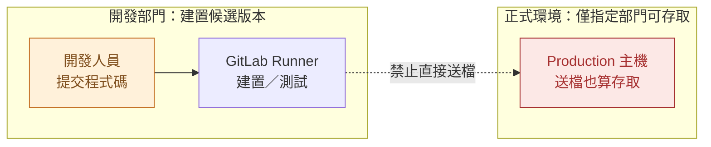
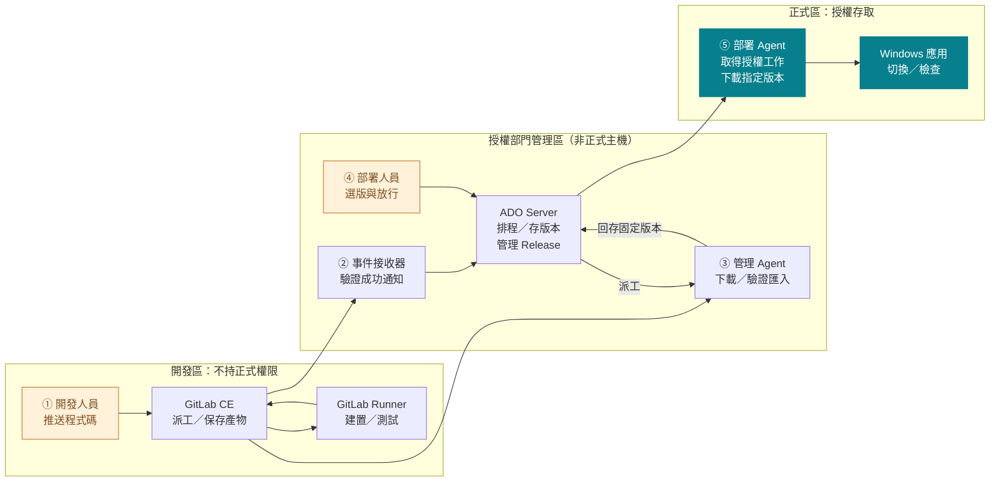
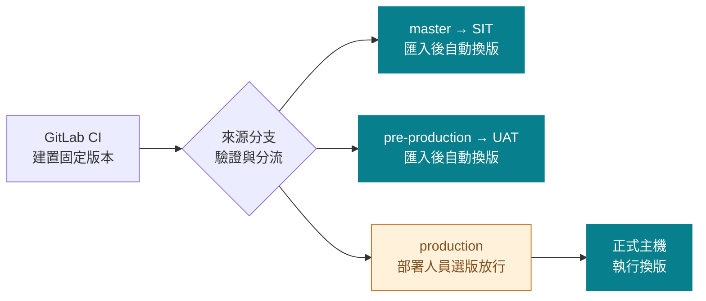
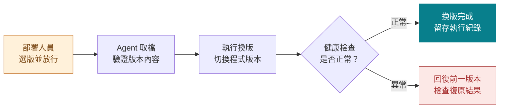
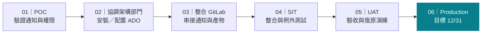

# Windows 正式部署治理計劃
> 保留 GitLab 建置，讓正式換版由授權部門掌握

## Azure DevOps Server 導入提案
- Express 作為 POC 起點｜正式版本另行確認
- 跨部門討論稿｜目標 12/31，時程待共同確認

<!-- notes
共 7 頁：封面、議程、5 頁內容（包含最後的建議時程），無附錄。僅討論 Azure DevOps Server；Express 是 POC 起點，不代表最終採購決策。保留 GitLab CE 作版本控制與 CI。其他部門已有 ADO 運行先例，是使用者提供的背景，不是本案整合或合規已通過的證據。12/31 年份未指定，不自行補年份。產品能力依官方文件查證，尚未完成本架構的實機驗證。
-->

---

# 今天看五件事：原因、架構、環境、換版與時程
> 先對齊責任邊界，再確認如何導入

## 為什麼改
- 01｜正式主機存取限制
- 02｜建置到部署的完整架構

## 如何運作
- 03｜三分支、三環境
- 04｜授權換版與失敗復原

## 如何落地
- 05｜POC 到正式上線
- 以 12/31 為目標倒排里程碑

<!-- notes
先交代開發端直接送檔的方案為何不可行，再用同一張完整架構圖依編號說明。為守住總共 7 頁，不增加重複圖頁或動畫頁；講者沿架構圖的 ①～⑤ 說明順序。圖的組織區域、人員與工具分開呈現，技術與權限細節留在講者備註及研究文件。
-->

---

# 只送檔、不換版，仍然越過正式主機存取邊界
> 原方案已否決：建置端不能直接碰正式主機

## 改變方向
- 保留建置自動化；檔案送入正式主機與換版，都改由授權流程執行。

<!-- notes
本頁合併舊版第 2、3 頁。只送檔、不執行換版的提案已被否決，原因是正式主機僅允許指定部門存取，複製檔案也屬存取；不是技術做不到，也不是宣稱 GitLab CE 沒有權限控制。虛線代表禁止路徑。現有 Container 鏈 GitLab → Harbor → Argo CD → OCP／Docker 可作責任分工類比，本案補上 Windows 的受控部署流程，不要求使用相同工具。建置端不能透過共用目錄、帳號或中繼腳本繞過 Production 邊界。
-->

---

# 建置完成主動通知，ADO 接手匯入與授權部署
> 分區＝責任邊界；橘色＝人員；箭頭＝工作／產物交接

## 架構要點
- 接收器與匯入邏輯需實作；管理 Agent 不碰正式主機，每台目標另有部署 Agent。

<!-- notes
沿 ①～⑤ 說明同一張完整架構圖，不增加重複頁。ADO 全名 Azure DevOps Server，POC 使用 Express；基線 Server 2022／REST 7.0，實際版本與修補層級待安裝確認。本圖是文件支持的目標架構，不是已實機測通的現況。
① 開發人員 push 到 GitLab CE；GitLab 編排 CI，GitLab Runner 執行建置／測試並將 artifact 上傳回 GitLab。Runner 沒有 Production 存取權或 ADO 部署憑證。
② GitLab pipeline 狀態成功後以 Pipeline webhook 主動通知管理側的受保護接收器；不是 GitLab Runner 直接觸發正式部署。接收器驗證認證、限制來源、耐久入列，再以 GitLab API 複核專案、成功狀態、來源分支、SHA 與必要品質 job，最後透過 Queue Build REST API 排入固定 importer。接收器是需實作的服務，不是另一個 GitLab Runner，也不是 ADO 原生 GitLab artifact connector；可評估與管理 Agent 共用非正式主機，但服務身分、憑證與目錄必須隔離。
③ ADO 需要管理區的 self-hosted Build Agent 執行 importer。圖中 GitLab→管理 Agent 是 API 下載的資料流，實際連線由管理 Agent 發起；ADO→管理 Agent 是派工語意，Agent 主動連 Server 取工作。Importer 重驗固定來源政策，按 project/pipeline/job ID 下載確切 artifact，檢查 ZIP 與內容、計算 hash、保存來源 manifest，再以 PublishBuildArtifacts@1 發布 Server Build Artifacts。不能用 Services-only Pipeline Artifacts，不能在部署時抓 latest。GitLab 唯讀憑證只留管理區。Management Agent 與 Production Deployment Group Agent 不共用主機、帳號或 pool；管理 Agent 不可寫入 Production。圖中 ADO 是控制面與受控版本儲存的概念集合，不代表所有元件必須同機。
④ 以三組固定 importer／Classic Release 綁定來源環境，下一頁展開。SIT／UAT 可在匯入成功後自動建立 release／部署。Production 關閉 artifact 自動 release trigger，由授權人員選確切 importer build 建立 Release；stage 設 Manual only 與具名 pre-deployment approvers。允許同一授權人員發起與放行，不強制雙人審批。放行綁定應用、目標與確切內容，改版或改目標須重新放行。
⑤ 圖中 ADO→部署 Agent 是已授權工作的交接，不是 Server 主動登入 Windows。每台 Windows Target 安裝專用 Deployment Group Agent，主動連 ADO 取工作，放行後才下載指定 build 產物並以受保護的部署腳本切換本機應用。此處畫 Production，SIT／UAT 使用各自隔離的 target Agents。沒有另藏一個需要登入正式主機的管理 Runner；本方案使用目標 Agent 本機執行。必須測試未放行時正式主機連 Agent 工作目錄都沒有候選檔案寫入。
安全邊界：接收器的 PAT／帳號只允許排入固定 importer，不具有 Release／Production 權限；PAT scope 不等於 definition ACL，須測試群組繼承、來源分支／參數覆寫、build service 身分與 OS 帳號的有效權限。部署定義、來源映射與特權腳本由授權部門管理，不能執行 artifact 附帶的特權腳本。記錄人員、版本、目標與結果。
可靠性：接收器耐久 inbox、去重、重送與 importer 候選唯一鍵，處理 Queue 回應遺失、重複事件及晚到舊版本；不讓重複匯入再觸發部署。必要品質 jobs 必須成功，不能只信任 allow_failure 後仍 success 的 pipeline。正常路徑為事件驅動；漏事件由受控補送走同一驗證流程，並監控 webhook 停用與產物保留期限。
研究取捨：CI 最後一個 job 直呼 Queue API 有官方功能基礎，但持有匯入排程權限且整條 pipeline 此時可能仍 running，需要事件後有限狀態重查；所以首選成功 webhook。Server 2020.1 起有 incoming webhook 功能，不能說是 Services-only，但其 HMAC 與 GitLab 的驗證格式不可假設相容。採接收器＋Queue API，不依賴未驗證的原生互通性。
完整查證與 POC 負向測試：docs/research/gitlab-ado-event-trigger.md。
https://docs.gitlab.com/user/project/integrations/webhook_events/#pipeline-events
https://learn.microsoft.com/en-us/rest/api/azure/devops/build/builds/queue?view=azure-devops-rest-7.0
https://learn.microsoft.com/en-us/azure/devops/pipelines/tasks/reference/publish-build-artifacts-v1?view=azure-pipelines
https://learn.microsoft.com/en-us/azure/devops/pipelines/release/deployment-groups/?view=azure-devops-2022
-->

---

# 三分支各自建置；正式環境多一道人工放行
> master → SIT；pre-production → UAT；production → Production

## 分流原則
- 成功通知不是正式放行；正式放行綁定確切版本與目標。

<!-- notes
保留舊版第 5 頁的三分支映射。三個分支各自建置，不主張同一份內容由 UAT 晉升 Production。接收器與 importer 用 GitLab API 複核固定專案、精確 ref、pipeline source=push、非 tag、SHA、成功狀態與必要 jobs，再路由到三組固定 importer＋單環境 Classic Release。Webhook 與 queue 參數只是提示，不是可信任的環境判斷。
ADO importer 儲存串接程式的 repository branch（例如 main）不等於 GitLab 來源分支；不得以 ADO Build.SourceBranch 或原生 build branch filter 推論來源環境。SIT/UAT 自動觸發，Production 關閉 artifact 自動 release trigger，授權人員選固定 importer build 建立 release、手動 stage 並通過 pre-deployment approval。開發者不能編輯部署定義、批准者或 Agent 資源繞過控制；只限制手動 Deploy 按鈕並不足夠。單人放行並執行符合目前需求。
https://learn.microsoft.com/en-us/azure/devops/pipelines/release/triggers?view=azure-devops-2022
https://learn.microsoft.com/en-us/azure/devops/pipelines/release/approvals/approvals?view=azure-devops-2022
-->

---

# 放行後才送入正式主機，換版失敗須能復原
> 固定版本 → 準備檔案 → 切換 → 健康檢查 → 留存結果

## 執行原則
- 每台主機由部署 Agent 執行受控腳本；記錄人員、版本、目標與結果。

<!-- notes
保留並調整舊版第 9 頁。放行前產物只在管理區保存，不能預拷到 Production（包含 Agent 工作目錄）；放行後部署 Agent 取固定 importer build 的 artifact，重新核對內容 hash，保存目前版本與復原資料，再依 IIS／Windows Service 的需求停止或切換、套用環境設定、啟動及健康驗證。不承諾零停機或跨主機原子交易。
換版或健康檢查失敗時，依事先驗證的腳本回復前一可用版本並檢查；復原失敗則停止並通知負責人，不能記為成功。資料庫／資料格式變更須另設相容與資料復原方案，不能把回復程式檔案等同資料回滾。多台逐台執行、失敗停止後續換版，是否回復已成功目標由授權人員依既定程序決定。部署鎖避免同一目標衝突，晚到舊版本不可自動降版；顯式授權的回復另留紀錄。Agent 與 ADO 不會自動提供應用程式專用的復原，腳本、資料保留及演練必須實作。
-->

---

# 建議以 12/31 為目標，逐關驗證後再正式上線
> 暫定里程碑順序；各階段日期與資源由相關部門共同確認

## 上線門檻
- POC 先證明「未放行不能送檔」；驗收與復原演練通過後，才申請正式上線。

<!-- notes
依使用者授權提出暫定階段，不是跨部門承諾。截止目標是 12/31，年份未指定，階段起迄日、工期、資源與正式核准均待共同確認。若必要驗收未通過，應調整範圍／資源或重新協調時程，不能因日期目標繞過上線門檻。
01 POC：使用隔離的 Express 評估環境，驗證 success webhook、受控 importer、最小 ACL、Production 零預拷、三分支分流與失敗復原。此處先使用評估環境，02 才與主機／Server 團隊（架構部門）協調受管理的 ADO 安裝，不暗示尚未安裝就可跑 POC。
02 協調：確認架構、主機、網路／TLS、服務帳號、管理責任、備份與監控；Express 僅為 POC 起點，正式版本另行確認。
03 整合：完成受保護接收器、管理 Agent、固定 importer／Release、目標 Agents、產物保留與稽核串接。
04 SIT：三環境路由、偽造事件拒絕、重送／亂序／中斷復原、版本一致性與權限負向測試。
05 UAT：由授權部署人員驗收選版放行、操作紀錄與實際應用的回復演練。
06 Production：依組織程序取得上線批准，先試辦再觀察；目標 12/31，不代表目前已批准。所有詳細 go/no-go 條件見 docs/research/gitlab-ado-event-trigger.md。
-->
